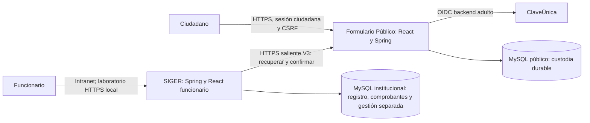

# Dos aplicaciones independientes · actualización 19-10-2026

Se conserva la decisión de separar Formulario Público de SIGER. Ahora SIGER incorpora un [núcleo funcionario provisional](NUCLEO_INSTITUCIONAL_LAB.md), conforme al [flujo para validación](flujo.consolidado-sinformsinbit.md).

El ciudadano no necesita acceder a SIGER ni su backend requiere conexiones públicas entrantes a la VM. SIGER inicia recuperación y ACK por HTTPS. SIGER es fuente definitiva del registro institucional; la aceptación técnica pública es distinta. El comprobante acredita registro, no clasificación/asignación/decisiones futuras. El alojamiento y transporte productivos siguen pendientes de habilitación.

| Aplicación | Vigente | Pendiente |
|---|---|---|
| Público | Adulto CU previamente validado en Sandbox, NNA provisional, React, sesión/CSRF, identidad/procedencia, MySQL, idempotencia, firma/reservas/ACK y comprobante institucional recuperable | Formularios finales, alojamiento, privacidad/retención y protección/aprobación productivas |
| Institucional | Registro/folio, verificación/ACK conciliado; núcleo de laboratorio con manual, destinos, Casos/Requerimiento, actuaciones/revisión, BAJA y solicitud/aceptación de derivación (F04 confirmada), evaluación de antecedentes, solicitud/aprobación/rechazo de reapertura ordinaria y avisos internos | Reglas DDN, autenticación funcionaria real, matriz sensible, rechazo/cancelación de derivación, encaminamiento de vínculos solo a Requerimiento, excepciones de reapertura DERIVACION, bitácoras sectoriales y despliegue/operación intranet |

Ambas usan Java 25, Boot 4.1.1 y Maven; cada JAR empaqueta su propio React. Builds y configuración independientes, sin compartir sesión, cliente OAuth, dependencia Maven de negocio ni esquema de aplicación. El acuerdo entre ambas sigue siendo [HTTP V3 y fixtures firmados](../contratos/registro-comunicacion-v3.md). La [API funcionaria](../contratos/nucleo-institucional-lab.md) usa sesión/CSRF, sin tokens técnicos en React.

El laboratorio reutiliza MySQL portable existente con esquemas/cuentas separados y Caddy/certificado ya confiable: 443 público, 8443 institucional, backends 8080/8081 loopback. Es comodidad local, no definición de infraestructura institucional. No se agregan brokers, gateway, contenedores ni identidad externa. Ambos backends también operan con el otro detenido, comprobado en la entrega.

Estados de reserva/custodia/ACK permanecen en tablas técnicas. V5 agrega gestión core_* referida al registro original, sin modificar cuerpo/comprobante firmado. Se conservan lectores/documentos históricos; los scripts de archivos corresponden a etapas anteriores, MySQL/Flyway transaccional ya existe.

PISEE/SRCeI sigue pendiente de conectividad, permisos e identidad institucional. No participa en el núcleo ni sus pruebas; el taller Notificador no se convierte en identidad DDN. No se alteran DNS, CA, infraestructura, QA/Producción ni SIGER legado.

