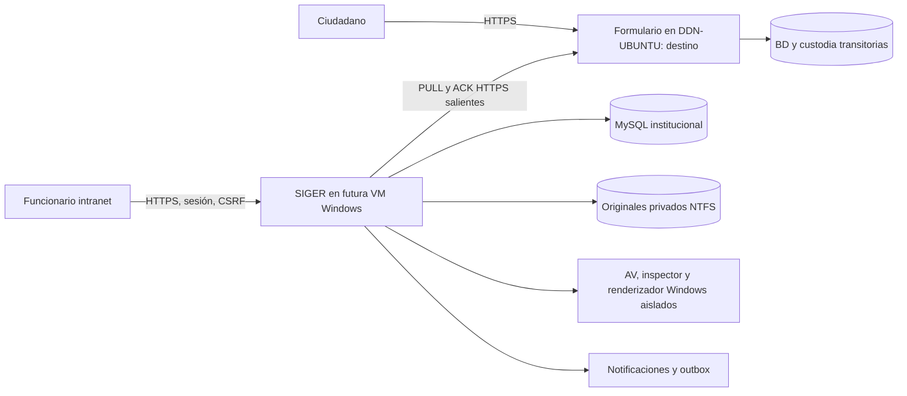

# Arquitectura vigente y mapa de módulos

SIGER es un monolito modular Java 25/Spring Boot4.1.1 con React/TypeScript empaquetado en el mismo JAR. No depende de un clone del Formulario para compilar. MySQL institucional y almacenamiento privado forman su conservación; el Formulario es un productor independiente.

El diagrama es de responsabilidades/destino, no de red aprobada. Actualmente ambas aplicaciones están en DDN-TEST-SIGER: SIGER Windows nativo y Formulario WSL. No hay una tercera máquina llamada WSL. No se inventan hostname/IP de la futura VM, VLAN, VPN, firewall, DNS o SLA.

## Código y responsabilidades

Raíz Java `siger-institucional/backend/src/main/java/cl/nexbyte/siger`:

| Paquete | Responsabilidad y clases de referencia |
| --- | --- |
| `contrato` | Componentes de identidad y declaración NNA, compatibilidad histórica |
| `institucional.robustez` | `BaseJdbc`, Flyway explícito, COM/registro/firmas, cola histórica V3, controles CAS, eventos, conciliación |
| `institucional.formulario` | `EntregaCompleta`, `FuenteFormulario`, `RecuperarFormulario`, custodia, endpoints autorizados de originales y scheduler completo |
| `institucional.archivos` | Configuración privada, barreras POSIX/NTFS, ACL y validación de rutas |
| `institucional.documental` | Antivirus, inspector, renderizador, gestión funcionaria, autorización por recurso, diario/temporales y visor |
| `institucional.identidad` | Cuentas, roles/alcances/vigencias, administración TI y catálogo territorial persistente |
| `institucional.nucleo` | Comunicaciones, distribución, destinos, Requerimientos/Casos, actuaciones, antecedentes, derivaciones/reaperturas y sesión funcionaria |
| `institucional.notificaciones` | Resolución autorizada de destinatarios, avisos, tareas personales, outbox y transporte Graph/simulado |
| `institucional.solicitudes` | Preparaciones U5 y sus límites institucionales explícitos |
| `institucional.windows` | Bootstrap Windows QA cerrado, secretos por stdin y activaciones explícitas |
| `institucional.integracion` | Demostraciones anteriores de archivos; no fuente de conservación vigente |

React está en `siger-institucional/front/src`. `App.tsx`/`api.ts` resuelven navegación/sesión; `Comunicacion.tsx`/`FormularioRecibido.tsx` muestran el ingreso íntegro y documentos; `VisorDocumento.tsx` presenta derivadas seguras; las pantallas de identidad, tareas/avisos y Solicitudes reutilizan la API funcionaria. La visibilidad de botones no sustituye políticas del backend.

## Límites de confianza

- HTTPS ciudadano y sesión pública pertenecen al Formulario. Clave Única/SRCeI no son autenticación funcionaria de SIGER.
- `/nucleo/**`: identidad individual vigente, HTTPS, sesión y CSRF; autorización por recurso/unidad/sede/asignación.
- `/operacion/v1/**`: autenticación técnica separada, controles auditados y telemetría sin contenido ciudadano. No entregar Bearer a React.
- PULL: CA/hostname, Bearer y claves Ed25519 confiables separadas. No redirects ni trust-all. Firma pública y ACK institucional no son la misma clave o documento.
- MySQL: aplicación DML y migrador separados. Sin Flyway/DDL para operar normalmente.
- NTFS: originales fuera de Git y de rutas web, sin nombres ciudadanos como ruta, validación contra enlaces/reparse points, bloqueo, barreras reales y recuperación ante fallos.
- Parsers: AppContainer sin capacidades + Job Objects; límites y fallo cerrado. Backend no ejecuta Office ni parsers con su token.

## Versiones y componentes comprobados

Java 25, Boot4.1.1, JNA5.19.1, Flyway 12.4.0 y Connector/J9.7.0 en el candidato actual; frontend Node 24 y versiones exactas en `package-lock.json`. MySQL Windows8.0.46 fue compatible con la transferencia lógica desde8.4. Las versiones del equipo nuevo deben verificarse; no actualizar MySQL compartido por conveniencia.

Binarios documentales y versiones/SHA: `scripts/windows-documental/tools-lock.json` y manifiestos privados de la instalación. No se versionan `.exe`, `.dll` o definiciones AV. La cadena nativa y sus ocho controles están descritos en [operación documental](OPERACION_DOCUMENTAL_WINDOWS.md) y [matriz](MATRIZ_SEGURIDAD_DOCUMENTAL_WINDOWS.md).

## Disponibilidad y fallos

El núcleo consulta registros ya conservados aunque el Formulario esté caído. La indisponibilidad remota afecta nuevas extracciones/ACK y activa backoff; no inventa confirmaciones. La conservación institucional no depende del agente de respaldo independiente ni de una política pública de72h. SIGER no activa eliminaciones o retención del Formulario.

El proceso de desarrollo es continuo pero no un servicio productivo supervisado. JAR por SHA y configuración privada se conservan fuera de `target`; compilar/commit/push no los sustituye. La futura supervisión, arranque institucional y recuperación operativa se aprobarán en sus gates.
