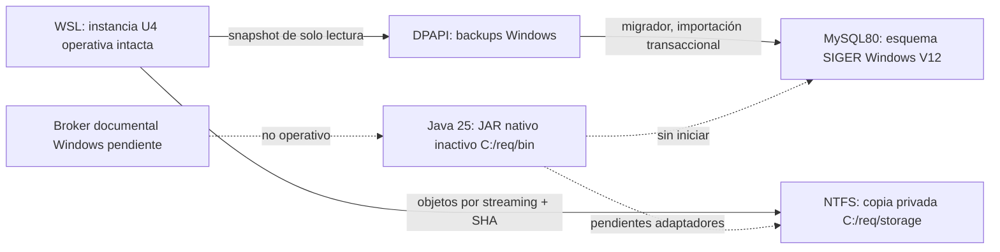

> **Nuevo corte del adaptador:** corregida la propagación ACL y pasada Java real0/1/2; refuerzo JOB_LIST compilado, pendiente de validación en vivo por RAM. No hay aprobación de las cinco documentales ni cierre de U4.5. Ver [checkpoint actual](CHECKPOINT_ADAPTADOR_AV_WINDOWS_2026-10-26.md). Se conserva la evidencia anterior abajo.

> **Reanudación posterior:** [ClamAV independiente aprobado](VALIDACION_CLAMAV_WINDOWS_2026-10-26.md),218 correctas H2/218 MySQL QA y5 documentales omitidas. Adaptador Java por validar, no habilitado; la RAM vuelve a bloquearlo. Ver [checkpoint vigente](CHECKPOINT_CLAMAV_WINDOWS_2026-10-26.md). No es cierre de U4.5; se conserva el informe anterior.

> **Último corte 26/10/2026:** runtime QA Windows/HTTPS/Edge verificado;214 correctas H2 y214 MySQL,42 frontend,5 documentales pendientes. Objetivo 100% nativo mantenido y ensayo AV ampliado aplazado por el usuario. Ver [checkpoint vigente](CHECKPOINT_RUNTIME_WINDOWS_2026-10-26.md) e [informe](RUNTIME_QA_WINDOWS_2026-10-26.md). U4.5 sigue abierta.

> **Continuación anterior 26/10/2026:** NTFS y Graph portables; H2/MySQL QA nativos 208 correctos por motor y 5 workers pendientes. Ver [checkpoint NTFS](CONTINUACION_NTFS_WINDOWS_2026-10-26.md) y [evaluación inicial](EVALUACION_WORKERS_WINDOWS_2026-10-26.md). El corte original del 25/10 se conserva íntegro a continuación.

# U4.5 — Migración Windows: cierre parcial de sesión, 25/10/2026

**La unidad U4.5 sigue abierta. No existe todavía un SIGER institucional completo ejecutándose nativamente en Windows.** Se completaron preservación de Git, traslado verificado de datos y objetos, compilación y comprobaciones nativas independientes. La adaptación segura de custodia y workers sigue pendiente; no se eliminó ningún control para arrancar.

Implementación inicial: `b4a41ab`, rama `migracion-windows-laboratorio-2026`, repositorio `C:\req\repo`. Este informe/checkpoint se confirma en un commit local posterior. Sin push. U5 no iniciada. Producción deshabilitada.

## Fases y resultado

| Fase | Resultado comprobado |
|---|---|
| A: Git/compatibilidad | Transferencia íntegra de referencias e historial; revisión Windows/MySQL; completada |
| B: datos/objetos | V1–V12 ejecutadas en MySQL Windows; 504 filas de negocio y 24 objetos copiados y cotejados; completada como snapshot, sin cutover |
| C: runtime | Compilación nativa y DPAPI/JDBC operativos; adaptación NTFS y workers aún pendiente |
| D: validación | Frontend correcto; backend parcialmente correcto; MySQL funcional completo, HTTPS real y E2E nativos pendientes |

El origen WSL sigue siendo la instancia operativa y no se detuvo ni reconfiguró. El destino no procesa eventos, outbox ni recuperación pública. Ambas bases y custodias están separadas. No deben activarse dos escritores del mismo estado ni realizar cutover desde esta copia sin revisar cambios posteriores al snapshot y resolver los bloqueos.

## Preservación de Git

Se leyó íntegramente `C:\req\evidencias\SIGER_WINDOWS_ENTORNO_PREPARADO.md` y los informes, checkpoints, contratos y reversiones U1–U4. Se auditaron status/diff, historial, refs, stash y worktrees antes de modificar. Origen limpio, un worktree y ningún stash. No había cambios sin confirmar que transferir.

Se creó y verificó `git bundle --all` fuera del repositorio de origen, en `C:\req\evidencias\siger-origen-u4.bundle`. Se transfirieron sus seis referencias persistentes, además de HEAD, y se validaron con `git fsck --full` y comparación exacta de SHAs/árbol. Árbol baseline: `b77cc86cf66f3571b596388c8ec3bcf58ea669c4`.

| Rama conservada | SHA |
|---|---|
| main | 86cfe31ff2bd285f8a187e7a037bcf39de3122e5 |
| integracion-formulario-completo-multimedia-2026 | 3e5af854f372061b97b3e50842979cdeeb781631 |
| identidad-territorial-laboratorio-2026 | f665a1cb2be75abfec8919419a9048413dab4cb3 |
| notificaciones-tareas-graph-laboratorio-2026 | 78b7caf14129c95b63f3e63001d195a51abf2c51 |

`origin/main` y `origin/HEAD` se preservaron. Se comprobó el HEAD publicado por SSH: `86cfe31`. No se sustituyó el trabajo local por origin/main. Auditoría: 287 archivos tracked, cero colisiones por mayúsculas, symlinks o rutas de más de 250 caracteres bajo el destino. No se convirtió LF/CRLF ni se reescribió historial. Git Windows efectivo es 2.53.0, diferente del 2.56 indicado en preparación; no se reinstaló.

## MySQL: migración real 8.4 → 8.0.46

Se usó exclusivamente `siger_institucional_windows_lab`, en el MySQL80 existente. No se usó root Windows ni se accedió a C:\agente. No se modificaron otros esquemas, configuración o servicio MySQL.

JDBC nativo Java 25/Connector-J 9.7.0 comprobó TLS 1.3 con `sslMode=VERIFY_IDENTITY`, CA/truststore propios y sin fallback al almacén del sistema. Flyway 12.4.0 reconoció MySQL 8.0 y aplicó **las doce migraciones históricas sin modificar sus archivos**; validación posterior correcta. Los 12 checksums coinciden con WSL y los 24 archivos H2/MySQL permanecen iguales al baseline.

Antes de Flyway se detectó el privilegio CREATE VIEW ausente, necesario para las dos vistas de V9. Un probe recibió 1142 sin crear objetos. Se pidió la concesión temporal específica, el usuario la autorizó y se comprobó aplicada antes de ejecutar. Se avisó que **CREATE VIEW ya puede revocarse**; la última lectura de permisos está en la evidencia privada. La cuenta de aplicación permanece con SELECT/INSERT/UPDATE/DELETE. Su CREATE TABLE fue rechazado realmente con 1142, sin crear la tabla probe. El runtime normal no se ha arrancado; su separación completa debe verificarse también durante el arranque futuro.

Respaldo de origen: mysqldump lógico single-transaction, sin archivos físicos, y snapshot JSONL HEX de **60 tablas/516 filas**, mediante REPEATABLE READ / WITH CONSISTENT SNAPSHOT. Contienen contraseñas hasheadas y datos del laboratorio: permanecen cifrados con DPAPI CurrentUser fuera de Git. Los temporales plaintext exactos se retiraron solo tras cotejar SHA y descifrado.

Importación: 59 tablas de negocio, **504 filas**, confirmadas en una transacción. Solo las ocho filas semilla de seis tablas creadas por Flyway admiten upsert, tras comprobar que todo el destino corresponde exactamente al estado nuevo posterior a las migraciones. No se ejecutan borrados de datos ni REPLACE. Se deshabilitan FK únicamente en la sesión de importación para resolver el orden de referencias; antes del COMMIT se reactivan, se validan todos los vínculos simples/compuestos y se comparan íntegramente todas las huellas de tabla. Los CHECK siguen activos. Un fallo provoca rollback.

Dos intentos preliminares no llegaron a COMMIT: validación demasiado estrecha de identificadores y vinculación JDBC binaria de números. Se corrigieron la allowlist de nombres y la vinculación UTF-8; las huellas completas prueban el resultado sin truncamiento. El reintento posterior al COMMIT detectó la importación existente, verificó relaciones/huellas y añadió **cero filas**.

Se preservaron diez high-water marks AUTO_INCREMENT; se contrastaron sin caché de information_schema. La historia Flyway original completa está en el snapshot cifrado; Windows conserva su instalación real por el migrador, con fechas/autor de instalación nuevos y los mismos scripts/checksums. No se falsificaron las fechas del despliegue Windows ni se sobrescribió su historia con la de WSL.

| Invariante en Windows, consultado con la cuenta app | Resultado |
|---|---|
| Comunicaciones / COM únicos | 11 / 11 |
| Ingresos públicos / ACK pendientes | 7 / 0 |
| Casos / Requerimientos | 5 / 3 |
| Cuentas / identidad nexbyte | 9 / una sola |
| Roles vigentes distintos de nexbyte | 7 |
| Tareas personales de Caso / impuestas o sin Caso | 3 / 0 |
| Notificaciones | 16 |
| Intentos históricos Graph / confirmaciones humanas | 4 / 4 |
| Presupuesto histórico consumido | 4 de 4 |

Cada tabla de negocio coincide por recuento y SHA-256 de sus filas completas, con marcadores de NULL y representación HEX por columna. No se truncaron documentos, relatos o procedencias ni se cambiaron COM, firmas, comprobantes, ACK, contraseñas o correlaciones. Una comparación final también confirmó que el origen seguía igual al snapshot: 60 tablas/516 filas.

## Objetos y material privado

Se copiaron todos los objetos existentes, sin regenerarlos: **18 originales (16 ciudadanos y 2 de gestión), 6 páginas derivadas, 16.869.263 bytes**. Los 24 objetos coinciden por tamaño/SHA en WSL y NTFS y con sus metadatos SQL. Se conservaron las claves relativas de almacenamiento. No se copiaron locks de escritor ni temporales activos; el origen tenía cero temporales. No se activó un almacén mutable Windows.

Destino: `C:\req\storage\archivo\objects`. El manifiesto está versionado como `MANIFIESTO_DOCUMENTOS_WINDOWS_2026-10-25.json`. Copia y verificación son por streaming; esto acredita la integridad de los bytes copiados, **no una implementación nueva de publicación durable bajo fallos de energía en NTFS**.

Diez archivos privados esenciales del origen —configuración de referencia, firma/confianzas, TLS, credencial nexbyte/QA, allowlist y secreto Graph— tienen copia cifrada DPAPI CurrentUser en `C:\req\config\origen-dpapi`, con cotejo de descifrado. No se escribieron sus valores en Git, argumentos, logs o evidencias. No se copiaron las credenciales antiguas de MySQL para ejecutar Windows. Los secretos nativos MySQL se importan desde sus PSCredential Export-Clixml usando PowerShell; Java los recibe exclusivamente mediante stdin anónimo, no descifra CLIXML.

Se verificó la ACL protegida de C:\req y el acceso de usuario operativo/SYSTEM/Administradores en config, storage y scratch. La JVM creó una carpeta hsperfdata con lectura genérica de metadatos dentro de scratch; se retiró exclusivamente esa ACE mediante icacls y se desactivó PerfData para los procesos QA futuros. Ningún archivo secreto/documental tuvo esa ACE. No se modificaron ACL de raíz ni servicios compartidos.

## Compilación y pruebas nativas

Java 25 se selecciona por proceso; Java global sigue siendo 21. No se modificaron JAVA_HOME/PATH globales ni se instalaron herramientas duplicadas. Node/npm nativos resolvieron las dependencias del proyecto.

| Verificación Windows real | Resultado |
|---|---|
| Maven package, Java 25, frontend incluido | Correcto; artefacto inactivo en C:\req\bin |
| Frontend Vitest | 42 correctas |
| Frontend lint / Vite build | Correctos |
| Backend H2, selección funcional sin carga | 194 seleccionadas: **128 correctas, 61 errores, 5 omitidas**, cero fallos de aserción finales |
| MySQL 8.0.46 real | JDBC TLS ambas cuentas, V1–V12, importación, replay, hashes, FK, secuencias y privilegios comprobados |
| Batería funcional completa MySQL | **Pendiente; no se ejecutó sobre la copia importada** |
| HTTPS real, cookies/CSRF, login nexbyte y E2E del runtime Windows | **Pendientes; no hay runtime completo Windows iniciado** |
| Graph | Cero nuevos envíos reales; 8 tests H2 de outbox con transporte simulado correctos; 6 tests del cliente bloqueados por fixture POSIX |

Los 55 errores documentales se producen en los permisos POSIX de ArchivoInstitucional y los 6 restantes en el fixture POSIX del cliente Graph. Una ejecución preliminar también detectó la canonicalización de rutas cortas del TEMP de Windows; se trasladó el TEMP de QA a C:\req\scratch\tests. Otra detectó una aserción 429 que cruzó el cambio de minuto: el reloj del filtro ahora admite inyección y el test lo fija; el runtime conserva Clock.systemUTC y los mismos umbrales/ventanas. Los cinco tests de workers reales siguen omitidos por falta de configuración Windows equivalente; no se cuentan como aprobados.

Las tres exclusiones de carga se comprueban por nombre antes de Maven: vectorInteroperableYDuplicadosConcurrentesTienenUnaConfirmacionEstable, doscientosFoliosDistintosBajoConcurrenciaYFormatoHistoricoEstable y consumidorParaleloAcotadoConservaUnicidadYConfirmaCadaRegistro. No hubo estrés ni proveedores gubernamentales.

Los fixtures MySQL existentes borran datos del esquema QA y rechazan URLs distintas del robust_inst_test Linux. No se les apuntó al esquema Windows conservado, ni se cambió esa guarda para permitir borrarlo. Falta provisionar un esquema/identidades QA Windows separados y adaptar su selección explícita con VERIFY_IDENTITY. Las 194 pruebas MySQL del baseline son históricas Linux y no se presentan como ejecutadas en Windows.

## Bloqueos de runtime: matriz de compatibilidad

| Componente | Linux conservado | Windows comprobado / pendiente |
|---|---|---|
| Java 25, React/Vite | U4 funcional | Compilan; frontend 42 correcto |
| MySQL / Flyway | 8.4 / V12 | 8.0.46 / V12 real; datos/hash idénticos |
| Credenciales JDBC | Archivos privados 0600 | DPAPI → pipe anónimo → JDBC, real |
| Cuentas/roles/territorio | Funcionales | Datos íntegros; tests H2 de identidad correctos; E2E real pendiente |
| ArchivoInstitucional | POSIX 0700, fsync archivo/directorio, rename y lock | Copias/ACL/SHA correctos; **adaptador NTFS aún no implementado** |
| Primitivas Java NTFS | No aplica | force de archivo, ATOMIC_MOVE y lock funcionan; force de directorio recibe AccessDeniedException; permisos POSIX UnsupportedOperationException |
| UnixDomainSocket Java | Operativo | La API abre sockets Unix en Windows; eso NO traslada endpoints Linux ni acredita aislamiento |
| ClamAV | Worker Linux existente | No hay scanner institucional nativo configurado/verificado |
| Inspector / sandbox | Landlock3/seccomp + límites | Helper Linux no ejecutable nativo; **broker Windows equivalente pendiente** |
| Poppler | Render aislado con prlimit | Existe binario Windows en runtime de herramientas; no es un renderer institucional aislado validado |
| Graph / allowlist | 4 envíos confirmados, automático false | Historial y material privado preservados; ningún transporte real activado |
| HTTPS institucional | WSL 20443, conservado | 8080/8081 libres al cierre; ningún listener nuevo ni E2E native |

Los guards privados de bootstrap/mail basados en POSIX y en user.home/.local también requieren adaptación a NTFS/DPAPI; las pruebas directas de outbox no acreditan esa configuración Windows.

No se sustituyeron fsync de directorio o sandbox por un no-op. Tampoco se habilitó descarga pública, se omitió AV ni se conectó un worker WSL fingiendo ejecución nativa.

Alternativa técnica pendiente de ingeniería/pruebas: broker Windows con AppContainer sin capacidades de red, ACL por trabajo y Job Object con límites de memoria/CPU/procesos, más scanner nativo y transporte local autorizado. AppContainer controla acceso a recursos y los Job Objects límites del árbol de procesos; **combinarlos no acredita por sí solo equivalencia con el perfil actual**. Deben superarse pruebas de lectura externa, escritura fuera del trabajo, red, creación de procesos, timeout/crash y límites antes de habilitarlo. Referencias primarias: [AppContainer](https://learn.microsoft.com/en-us/windows/win32/secauthz/appcontainer-isolation), [Job Objects](https://learn.microsoft.com/en-us/windows/win32/procthread/job-objects).

Para custodia se necesita una implementación NTFS revisada de ACL/reparse points, publicación y durabilidad, probada con fallos controlados entre archivo/SQL antes de permitir ACK. No se infiere que ATOMIC_MOVE más force de archivo sustituya automáticamente fsync de directorio. Referencias: [FlushFileBuffers](https://learn.microsoft.com/en-us/windows/win32/api/fileapi/nf-fileapi-flushfilebuffers), [MoveFileExW](https://learn.microsoft.com/en-us/windows/win32/api/winbase/nf-winbase-movefileexw).

## Arquitectura y automatismos al checkpoint

El correo automático del origen permanece false. Windows no ejecuta motor de notificaciones ni transporte Graph; el presupuesto de cuatro sigue agotado y las cuatro confirmaciones humanas permanecen en MySQL Windows. No se cambió la campaña ni se enviaron correos adicionales. No hubo pull real ni conexión gubernamental.

No se crearon servicios Windows, tareas programadas, reglas de firewall o listeners. No se modificaron nginx, relays, SMID-Gateway, C:\agente, PISEE, ClaveÚnica, dominio/GPO, Formulario Público, MySQL80 compartido o el código/configuración de formulario-web.

## Reproducción y evidencia

Todos los comandos PowerShell siguientes son de una línea. Ejecutar desde la misma cuenta DPAPI. Los scripts de exportación inicial se niegan a sobrescribir el corte existente; no repetirlos sobre este destino.

- Compilación: `& C:\req\repo\scripts\Windows-Regresion.ps1 -Mode Package`
- Artefacto/dependencias, sin arrancar: `& C:\req\repo\scripts\Windows-Preparar-Artefacto.ps1`
- Frontend: `& C:\req\repo\scripts\Windows-Regresion.ps1 -Mode Frontend`
- H2 (resultado todavía no correcto): `& C:\req\repo\scripts\Windows-Regresion.ps1 -Mode H2`
- JDBC/permisos: `& C:\req\repo\scripts\Windows-BaseDatos.ps1 -Mode inspect -Identity app`
- Flyway validate: `& C:\req\repo\scripts\Windows-BaseDatos.ps1 -Mode validate -Identity migrator`
- Integridad SQL/Graph histórico: `& C:\req\repo\scripts\Windows-BaseDatos.ps1 -Mode audit -Identity app`
- Custodia NTFS: `& C:\req\repo\scripts\Windows-Verificar-Custodia.ps1`
- Backups DPAPI: `& C:\req\repo\scripts\Windows-Proteger-Snapshots.ps1`
- Comparación de origen, solo lectura Linux: `wsl -d Ubuntu-24.04 -u root -- python3 /mnt/c/req/repo/scripts/Windows-Comparar-Origen.py`

El importador `Windows-Importar.ps1` ya fue probado tras COMMIT con resultado alreadyImported/0 filas. No elimina datos para acomodar una divergencia: se detiene. El uso de WSL/Docker para exportar/comparar el origen es una herramienta de migración, no evidencia de runtime nativo.

Evidencias privadas: C:\req\evidencias y C:\req\logs. Incluyen bundle/ref/árbol, inventario, manifests, estado post-Flyway/importado, huellas por tabla, checksums, secuencias, privilegios, resultados/suites nativas, DPAPI y artefacto. Resumen sanitizado versionado: EVIDENCIA_MIGRACION_WINDOWS_2026-10-25.json. Artefacto de checkpoint: C:\req\bin\siger-a8bed7746c55ea4f.jar, SHA-256 a8bed7746c55ea4f17a2c9edf31dbf9c4105931eb9825e43feb9d531bdb49d1e; nunca se ejecutó desde target.

## Siguiente acción exacta y límites

1. Completar/verificar el adaptador NTFS y el broker documental nativo, conservando el fallo cerrado actual. No activar ACK ni cargas sin estas garantías.
2. Preparar QA MySQL Windows aislado y ampliar las guardas de tests únicamente para ese destino descartable; jamás usar la copia importada para fixtures destructivos.
3. Implementar arranque/parada Windows con DPAPI, app DML, HTTPS válido, loopback, Graph real deshabilitado y recuperación pública deshabilitada; sin servicio permanente. No reutilizar indiscriminadamente las propiedades Linux cifradas como configuración Windows.
4. Ejecutar de nuevo H2/MySQL, workers reales Windows, HTTPS/Edge, cuentas/revocaciones/documentos/tareas, outbox simulado y reinicios. Cero nuevos correos reales.
5. Solo después preparar el cutover verificable. Si exige detener/reconfigurar WSL, servicios compartidos o privilegios extraordinarios, obtener la autorización específica exigida en el encargo antes de actuar.

No se declara equivalencia completa, E2E nativo ni producción lista. Backups externos, recuperación de desastre, retención y hardening conjunto siguen pendientes; las copias locales en el mismo disco no los sustituyen.
