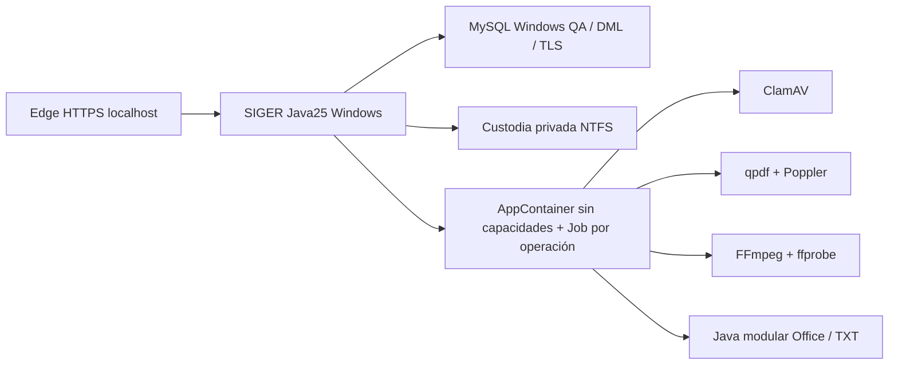

# Cierre técnico U4.5 — SIGER Windows Server 2022

**Dictamen: U4.5 COMPLETADA en QA nativo Windows. Producción deshabilitada.**

26/10/2026. Repositorio `C:\req\repo`, rama `migracion-windows-laboratorio-2026`. Código `2db9783`; documentación y comprobador de evidencia en el commit posterior de cierre. Sin push. Se conservaron los commits y cortes anteriores, el repositorio WSL, V1–V12, datos históricos, firmas y custodias.

## Resultado

SIGER ejecutó el circuito institucional con Java25, MySQL8.0.46/TLS1.3 `VERIFY_IDENTITY`, credenciales DPAPI, HTTPS localhost, cuentas individuales, siete roles de nexbyte, autorización por recurso, Comunicaciones, distribución, Requerimiento/Caso, documentos, tareas de Caso, notificaciones y outbox simulado. Antivirus, inspección y representaciones funcionan en procesos Windows aislados. No hay worker Linux ni dependencia operacional de WSL.

Se eligió un único lanzador Java de operaciones documentales cerradas, con AppContainer y Job Objects; no se instaló un broker, servicio, contenedor, motor Office ni runtime Linux. Herramientas privadas verificadas: ClamAV1.4.6, qpdf12.4.2, Poppler26.09.0-0, FFmpeg8.1 LGPL compartido y una imagen Java modular para XML Office/TXT. El código y los preparadores están versionados; los ejecutables y manifiestos privados permanecen fuera de Git.

## Compatibilidad Windows/Linux

| Componente de origen | Implementación Windows acreditada | Alcance |
|---|---|---|
| MySQL8.4 / V1–V12 | MySQL8.0.46, transferencia lógica previa conservada, TLS y separación DDL/DML | Histórico idéntico y regresión QA nativa |
| Archivos privados POSIX | ACL NTFS, rechazo de reparse/junctions, locks, publicación con barreras y conciliación | Adaptador NTFS previo conservado; no se equipara fsync a una operación vacía |
| clamd/socket Unix | clamscan portable privado, un archivo por proceso aislado | Coste de carga medido cercano a8s por análisis; no se ensayó throughput |
| Inspector Linux y parsers | qpdf/FFmpeg/Java modular en AppContainer | Sin sockets Unix, Python ni ejecutores Office en runtime |
| Renderizador Poppler Linux | pdfinfo/pdftoppm Windows privados | PDF de tres páginas real y vistas nativas en Edge |
| seccomp/Landlock/rlimit | AppContainer/ACL/Job/handles explícitos/journal | Primitivas diferentes; equivalencia funcional acotada por ocho pruebas, no equivalencia formal del kernel |
| Secretos privados de entorno | DPAPI CurrentUser y stdin de proceso protegido | Sin contraseñas en argumentos, repositorio o variables globales |
| React/Vite/Node Linux | Node/npm Windows y Edge real con HTTPS |42 tests/lint/build; sin cambiar lógica funcional del frontend |

La rama conserva las implementaciones Linux; no se usaron como worker auxiliar ni se ejecutó allí la regresión de esta entrega.

## Pruebas del código definitivo

| Verificación Windows nativa | Correctas | Fallos/errores | Omitidas |
|---|---:|---:|---:|
| Backend H2 |229|0|0|
| Backend MySQL QA |229|0|0|
| Frontend |42|0|0|
| Cinco métodos documentales históricos, incluidos en ambas baterías |5 por batería|0|0|
| JUnit AV dedicado |1|0|0|
| AV Java: limpio/EICAR/indisponible |3|0|0|
| Sonda del lanzador: fronteras, recursos, mutex y recuperación |9|0|0|
| Edge HTTPS/MySQL/NTFS: operación con documentos reales sintéticos |127|0|0|
| Edge después de reiniciar JVM, misma custodia y datos |110|0|0|
| Edge/HTTP institucional: distribución territorial y central |34|0|0|

Frontend lint/build y empaquetado Maven correctos. Las tres exclusiones históricas de estrés se conservaron; no se añadieron exclusiones. Los ensayos dedicados y el E2E son evidencia adicional: no se suman a229 para inflar la batería.

Los cinco métodos pendientes de `ServiciosDocumentalesRealesTest` quedaron ejecutados: PDF de tres páginas/aislamiento/render, imagen derivada/AV, EICAR, PDF activo/extensión falsa y Office/referencia externa. Se añadieron pruebas reales de los demás formatos y ZIP/XXE/links/estructura/perfiles inválidos. Ver [matriz de los ocho controles](MATRIZ_SEGURIDAD_DOCUMENTAL_WINDOWS.md).

Edge verificó login, cookies Secure/HttpOnly/Strict, CSRF, TI, siete roles, invalidación de sesiones al revocar/desactivar, denegación entre unidades y TI sin facultad operativa, COM único y reintento después de reinicio, Requerimiento/Caso y tarea persistentes, notificaciones y correo SIMULADO. En documentos verificó carga privada, PDF multipágina, zoom200%, escritorio/móvil, PNG derivado, descarga/hash, repetición de carga, origen determinado por servidor, rechazos422 y fallos503 sin publicar, y permisos negativos sobre originales y páginas.

El ensayo territorial comprobó que el coordinador regional distribuye una Comunicación de su propia sede y no una ajena ni un ingreso web sin sede, mientras distribución central puede distribuir el origen ajeno. Ni recibir ni distribuir creó automáticamente Casos/Requerimientos. Las asignaciones y el perfil temporal de la cuenta restringida fueron restituidos al terminar.

## Integridad y conservación

- Comparación SQL con el snapshot importado:59 tablas, **504 filas, todas las huellas y recuentos idénticos**. Auditoría histórica mantiene una cuenta nexbyte, siete roles, cuatro Graph aceptados/cuatro confirmados, presupuesto histórico cuatro y cero ACK pendientes.
- Custodia histórica: **24 objetos,16.869.263bytes**, mismos SHA-256; ACL privada y herencia externa deshabilitada. No se regeneraron originales ni se importaron otra vez.
- Flyway V1–V12 intacto y validado. `SHOW GRANTS` confirma retirada de CREATE VIEW del migrador histórico. QA conserva migrador separado con DDL/CREATE VIEW y aplicación solo SELECT/INSERT/UPDATE/DELETE. Ningún runtime usó root o DDL.
- QA final:10 COM únicos,4 ingresos públicos sintéticos,10 originales documentales,3 representaciones y5 páginas;1 Requerimiento,1 Caso,1 tarea,13 notificaciones/outbox,1 intento simulado y0 aceptados por Graph. Cero COM duplicados y cero ACK pendientes. Incluye fixtures manuales de intentos intermedios conservados, no eliminados para limpiar resultados.
- JAR definitivo `C:\req\bin\siger-97ec9558588182cd.jar`, SHA256 `97ec9558588182cdb67b68c8548ecf8fd5d6c0beb20c97aad7f2e9399c9270ea`.225 clases coinciden con el candidato compilado/probado. No se sobrescribió un JAR activo.

## Alcance de recepción y ACK

Los contratos completos1.0/1.1 y el V3 histórico no se modificaron. Las regresiones verifican estructura, firmas Ed25519, contenido/procedencia, streaming, integridad, reservas, errores de almacenamiento/red, COMMIT y recuperación de ACK perdido/duplicado. La custodia se consulta sin depender de habilitar el transporte externo; se corrigió ese acoplamiento en el controller de originales.

La recepción conserva la atestación de validación del productor confiable firmante; no se añadió una política de rescaneo universal previo al ACK. Gestión escanea/inspecciona antes de conservar y el visor antes de generar nuevas representaciones. Se preservan las fronteras de confianza históricas, con firmas, hashes y procedencia verificados.

Para el navegador se prepararon cuatro ingresos firmados: adulto CU simulado1.0, adulto declarado1.1, NNA con RUN1.1 y NNA sin RUN1.1, cada uno con PDF e imagen. Se usó el receptor institucional real, MySQL y NTFS; generación y verificación del comprobante y unicidad fueron reales. **El productor y la aceptación del ACK fueron simulados en proceso.** Los contratos de red usan fuente controlada loopback. Esto no se presenta como E2E nuevo contra el Formulario Público publicado.

Baseline público de referencia: `bc6489cd75c3dff9ff8462b8d0275d52f1045f29`. No se modificó ese repositorio, no se activó pull público ni lógica de retención en SIGER. No se depende del agente de respaldo. `ACK_RETENCION_LIMITADA_APROBADA` no autoriza ni activa eliminaciones o modalidad72h desde esta aplicación.

## Seguridad y recuperación

AV Java final: Clean0, EICAR1, Unavailable2. Se mantiene la guarda4GiB libres, Job1,5GiB/45sCPU/90s y un proceso. El Job se asocia durante CreateProcess antes de reanudar. Cada ejecución verifica token sin capacidades, pertenencia al Job, límites efectivos, huella de entrada y resultado. Exit0 sin confirmación del archivo actual también falla cerrado.

Parsers:512MiB,45sCPU/90s, salidas acotadas, rutas privadas y paquetes completos por SHA. Office/TXT se analiza fuera del token del backend, con DTD/entidades/XInclude externos deshabilitados, límites ZIP/CRC/ratio, rechazo de enlaces, macros, fórmulas activas y estructuras peligrosas. PDF se verifica con qpdf antes de renderizar con Poppler; FFmpeg decodifica formatos restringidos bajo el mismo aislamiento. No se usan ejecutores Office.

Un journal durable precede a cambios de ACL. Al abortar la JVM, el Job elimina al hijo; una nueva JVM concilia solo el trabajo propio mediante PID+instante, SID y rutas configuradas. Restaura ACL, elimina perfil y temporales. Estados desconocidos, dueño vivo o journal inválido conservan fallo cerrado. No se matan procesos por PID conocido de un archivo ni se usa fsync vacío. Ver diferencias y alcance de NTFS en los informes previos y [operación](OPERACION_DOCUMENTAL_WINDOWS.md).

HTTPS utilizó el certificado localhost ya autorizado en CurrentUser; no se cambió confianza de máquina. No se modificaron Kaspersky, firewall, MySQL80 global, otros servicios o políticas. La exclusión testdata se usó solo para contenido sintético. La parada final confirmó **cero workers propios, cero jobs y cero listeners8080/8081**, sin secretos efímeros de los dos runtimes. WSL original permanece intacto.

## Evidencias reproducibles

Todo bajo `C:\req`, fuera de Git cuando contiene datos/credenciales:

- `evidencias\candidato-documental-u45.json`: artefacto/clases, imágenes, raíces y fuentes de evidencia.
- `logs\backend-h2-documental-final.log`, `logs\backend-mysql-windows.log`:229/229; `logs\frontend-{test,lint,build}-windows.log` y `logs\package-windows-final.log`.
- `evidencias\calificacion-documental-java-final.json`, `testdata\av-java-f38b6cc64f604240aaf5203e0c7f2232`, `testdata\av-junit-0120e08aeef440a092231f6eb6ac4b57`.
- `evidencias\edge-documental-operacion-u45.json`, `edge-documental-reinicio-u45.json`, `edge-territorio-u45.json`, `auditoria-documental-qa-u45.json`, `runtime-documental-inventario.json`, `parada-documental-u45.json`.
- Operación Edge: `testdata\runtime-qa-b20faf8ea44a4a098363ff589cd0ab55`; reinicio/territorio: `testdata\runtime-qa-3d9b6daa34814f82b8f9b162670d6230`. Incluyen capturas de PDF escritorio/móvil y documento ciudadano.
- Fixtures, configuración y stdout/stderr acotados por worker: `testdata\documental-win-4c816361d6ad4322a1bfd2e8c1dd2009`.
- `evidencias\comparacion-historico-u45-final.json`, `historico-u45-final.json`, `auditoria-historico-u45-final.json`, `migrador-historico-u45-final.json`, `custodia-u45-final.json`.

Los fallos intermedios no se ocultaron: ACL de un JAR temporal, classpath del primer inspector, validación de la ACE CREATOR OWNER heredable y fixtures territoriales con presencia inexistente. Se corrigieron sus causas; no se debilitaron criterios, permisos o límites. El inspector final es modular y no depende del JAR de aquella prueba. Los stdout/stderr y cortes anteriores siguen conservados.

Comandos de preparación, arranque, parada, regresión y Edge en [OPERACION_DOCUMENTAL_WINDOWS.md](OPERACION_DOCUMENTAL_WINDOWS.md); retorno no destructivo en [REVERSION_MIGRACION_WINDOWS.md](REVERSION_MIGRACION_WINDOWS.md). Cada comando PowerShell para el operador está en una línea.

## Límites y siguiente etapa

El cierre corresponde a migración técnica en QA, sin cutover, servicio Windows permanente ni habilitación productiva. El reinicio probado es de JVM; no se reinició el anfitrión ni se ensayó corte eléctrico. La validación no sustituye mantenimiento de parches/CVE de terceros, respaldo institucional, monitoreo, decisión de cuenta de servicio ni hardening productivo.

Graph real continúa cerrado, sin nuevos correos ni cambios de tenant. No se llamaron ClaveÚnica/SRCeI ni servicios gubernamentales. No se alteraron otros servicios ni se implementó U5. SIGER queda preparado para continuar U5 en una unidad expresamente encargada: Solicitudes, respuestas directas, escalamiento y tareas independientes. El baseline de esta entrega debe conservarse antes de esa evolución.
