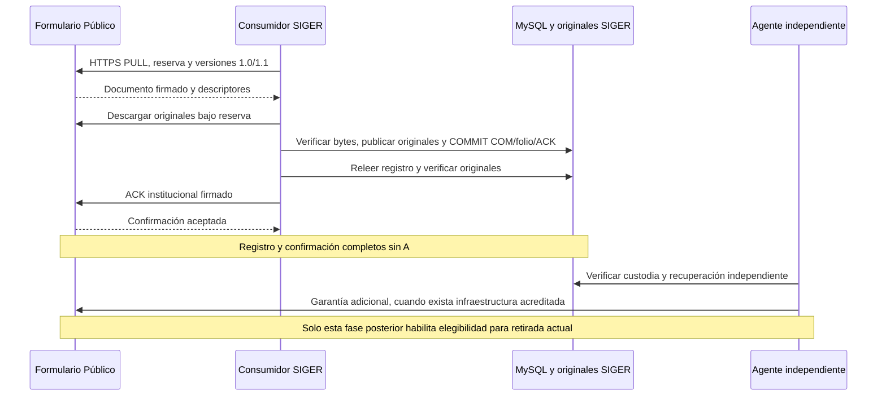

# Recepción de Comunicaciones sin agente de custodia

Corte: 26/10/2026. Verificación sobre el estado real de `C:\req`. **La recepción, el folio COM y el ACK institucional funcionan sin el agente.** No se encontró un acoplamiento que requiera cambiar código de negocio.

Esta evidencia prueba el circuito técnico completo de recepción con datos sintéticos. No declara desplegada la aplicación institucional Windows completa ni habilita producción o retirada pública.

## Referencias comprobadas

| Elemento | Referencia |
|---|---|
| SIGER, fuente local previa | `8411613d1a1e867d47f424c6afe0cf13db5780a0` |
| Rama de esta verificación | `verificacion-recepcion-sin-agente-2026-10-26` |
| Formulario publicado consultado | [b6ab36af4357f6852f035466b4653da97d267e00](https://github.com/chashmdai/formulario-web/tree/b6ab36af4357f6852f035466b4653da97d267e00) |
| JAR institucional ensayado, ya existente | `C:\req\bin\siger-847cd77c5af327be.jar` |
| SHA-256 institucional | `847cd77c5af327be992bc4e46aa83038f35f9f7b67229829c661412857c3b471` |
| SHA-256 JAR público ensayado | `d859b952eec59fbd1564a370e71c80cdbd2137472739a7dc761dfd2b4d2bd779` |

Se utilizaron las clases del artefacto institucional instalado y sus bibliotecas existentes. No se recompiló ni sustituyó ese JAR. El fixture público utiliza el JAR de laboratorio conservado en `.local/agente-tls-final-target` del repositorio público; su huella y la del fixture se registran en la evidencia privada. El runner exige el repositorio limpio en el commit indicado y ambos preparadores fijan las huellas de los artefactos ensayados. Una reconstrucción con otra huella requiere revisar su procedencia, no omitir la guarda.

## Dónde termina cada responsabilidad



El [consumidor real](../siger-institucional/backend/src/main/java/cl/nexbyte/siger/institucional/formulario/RecuperarFormulario.java) llama a `FuenteFormulario`, `ArchivoInstitucional` y `RecepcionInstitucionalJdbc`. No invoca al agente ni espera su garantía. `FormularioInstitucionalConfiguration` depende de la configuración de recepción, origen HTTPS, token técnico y custodia primaria local; el planificador tiene su propia habilitación y control operacional.

1. `FuenteFormulario` negocia `1.0,1.1`, reclama una entrega y descarga originales por HTTPS sin redirecciones, con token y reserva. La transferencia a archivo es streaming.
2. `validarCompleta` comprueba documento, huellas, procedencia y firma pública. `ArchivoInstitucional` comprueba tamaño/SHA-256, privacidad y barreras NTFS antes de publicar originales.
3. `guardarCompleta` registra en una transacción inbox, Comunicación, COM/folio, metadatos documentales y comprobante firmado. La repetición conserva el registro y su ACK.
4. Después del COMMIT, `registroCompletoConservado` vuelve a verificar el registro y sus originales. Solo entonces se envía el ACK; un error conserva `ack_pending` para conciliación.
5. En el Formulario, `RecepcionFormularioJdbc.confirmar` valida reserva y ACK y pasa la Comunicación a `CONFIRMADA` sin consultar garantías independientes. Estas se consultan posteriormente en `CustodiaTransitoria`/`CicloVidaCustodia` para retirada y minimización.

La custodia primaria de `ArchivoInstitucional` **sí es necesaria** para confirmar recepción; es distinta del respaldo independiente. Igualmente, el recibo público, el ACK institucional y la garantía de recuperación independiente son tres evidencias diferentes. No se modificó su significado ni la canonicalización/documentos 1.0/1.1.

Contrato: [consumidor completo 1.0/1.1](../contratos/consumidor-formulario-completo-1.1.md). Evidencias anteriores: [integración completa](INTEGRACION_FORMULARIO_COMPLETO_2026-10-24.md) y [estado Windows NTFS](CONTINUACION_NTFS_WINDOWS_2026-10-26.md).

## Laboratorio ejecutado y límites

- **SIGER:** Java 25 nativo Windows, clases reales del JAR instalado, MySQL80 8.0.46, `VERIFY_IDENTITY` y truststore específico de SIGER. Únicamente `siger_institucional_windows_qa`, cuenta DPAPI `siger_windows_qa_app` con DML. Sin root, migrador ni DDL.
- **Formulario:** nuevo proceso Linux/WSL, Spring MVC/Tomcat HTTPS, controlador y seguridad técnica publicados, servicios reales de recorridos, adjuntos, cargas y recepción; H2 y almacenamiento POSIX nuevos y privados. No se reutilizaron bases, puertos ni custodias públicas existentes.
- **Red:** HTTPS loopback con CA efímera de prueba y verificación de identidad/cadena; JDBC TLS real. Sin desactivar TLS ni alterar confianza global, firewall o hosts. La primera sonda de transporte IPv4-mapeado no cruzó WSL; `-Djava.net.preferIPv4Stack=true` en el fixture resolvió el transporte. No era un fallo del protocolo ni del agente.
- **Datos:** cuatro Comunicaciones y cuatro TXT pequeños completamente sintéticos: un documento 1.0 con BLOB histórico y tres 1.1 con archivo privado. AV/inspección son dobles explícitos y controlados del fixture; esta unidad no vuelve a calificar antivirus, formatos multimedia ni el formulario ciudadano.
- **Aislamiento:** hashes y cantidades de las filas QA preexistentes en `institutional_inbox`, `communication_registry` e `institution_document` se compararon antes/después, excluyendo únicamente los cuatro IDs propios. Permanecieron iguales. No se leyó ni modificó la base histórica `siger_institucional_windows_lab` o `C:\req\storage\archivo`.
- El control de recepción **QA** se habilitó temporalmente mediante su API auditada y se restauraron sus valores originales al finalizar; revisión/auditoría reflejan esa operación. No se cambió configuración activa de servicios.
- Puertos 8080/8081 conservados libres. Ningún servicio existente detenido o desplegado; solo terminó el proceso público creado para esta prueba. Sin llamadas gubernamentales, Graph, agente, garantías, tareas programadas o retiradas.

### Resultados de esta ejecución

| Escenario | Resultado observado |
|---|---|
| Recepción 1.0 | Original íntegro, un COM/folio, ACK firmado y estado público CONFIRMADA |
| Recepción 1.1 | Igual resultado, original privado FILE íntegro |
| ACK perdido después de persistirlo en el Formulario | COM visible desde otra conexión MySQL; ACK pendiente conciliado, mismo folio y mismo comprobante, sin segunda descarga |
| Primer original alterado en tránsito | Hash rechazado; cero COM y cero ACK para ese intento; reintento sano registra una sola Comunicación |
| Entrega repetida al servicio institucional | Se conserva exactamente el comprobante registrado; sin duplicación del COM |
| Formulario responde 503 | El consumidor comunica indisponibilidad; los cuatro registros y originales institucionales siguen íntegros |
| Formulario de prueba detenido completamente y nueva JVM SIGER | Recuperación de las cuatro Comunicaciones, originales y ACK desde MySQL/NTFS sin construir un cliente público |
| Estado público tras confirmar | Cuerpo conservado, ninguna retirada y cero garantías independientes |

**110 comprobaciones E2E correctas**, más lectura en frío en un proceso nuevo. Son comprobaciones del harness, no 110 métodos JUnit. El contador corresponde al E2E guardado; la lectura en frío posterior también comprobó expresamente las versiones 1.0/1.1 persistidas. Se conservaron las evidencias y los originales sintéticos, sin limpiezas de tablas.

Regresión focal nativa Windows/H2 realmente ejecutada:

| Clase | Pruebas | Fallos / errores / omitidas |
|---|---:|---|
| `RecuperarFormularioHttpTest` | 12 | 0 / 0 / 0 |
| `FormularioCompletoInstitucionalTest` | 16 | 0 / 0 / 0 |
| `ArchivoPlataformaTest` | 15 | 0 / 0 / 0 |
| **Total** | **43** | **0 / 0 / 0** |

Incluye firmas inválidas, rechazo de ACK, reserva vencida, duplicados, interrupción/timeout, alteración antes de conciliar y recuperación de proceso/almacenamiento. No se ejecutó la suite MySQL general: sus fixtures limpian tablas QA; se utilizó el harness acotado que preserva sus filas previas. Tampoco se ejecutó una regresión frontend o de toda la aplicación, al no haber cambios de runtime/UI.

No equivale a certificar el runtime web institucional Windows completo, Edge, workers documentales/AV reales, corte eléctrico, desastre físico o producción. Los pendientes de U4.5 documentados en el checkpoint NTFS siguen separados. El módulo de recepción probado no depende de esos workers ni del agente.

## Repetir y conservar evidencia

Fuentes QA opt-in bajo [scripts/qa](../scripts/qa); no se empaquetan en el JAR de SIGER ni en el Formulario. Los archivos de configuración, token, claves sintéticas, H2, originales, logs y manifiestos quedan fuera de Git. La credencial MySQL viaja por stdin anónimo desde DPAPI, sin argumentos ni archivo con contraseña.

Requisitos: identidad Windows propietaria de DPAPI, Java 25 ya instalado, bibliotecas existentes, esquema QA ya preparado, checkout público limpio b6ab y el JAR con la huella indicada. **No aplicar migraciones ni ejecutar esto contra otro esquema.** Cada repetición agrega cuatro registros sintéticos; no es un monitor ni una prueba de carga.

En PowerShell 7, desde `C:\req\repo`, preparar una raíz nueva y comprobar TLS/QA (cada comando ocupa una línea):

```powershell
$qa = & .\scripts\qa\Preparar-Recepcion-Sin-Agente.ps1 | ConvertFrom-Json; & .\scripts\qa\Recepcion-Sin-Agente.ps1 -Run $qa.run -Mode preflight
```

En una segunda consola, copiar solo el ID de ese run y mantener el fixture supervisado en primer plano hasta finalizar:

```powershell
wsl -d Ubuntu-24.04 -- python3 /mnt/c/req/repo/scripts/qa/recepcion-sin-agente-publico.py --id ID_DEL_RUN
```

Después de que anuncie `fixture-https`, volver a la primera consola:

```powershell
& .\scripts\qa\Recepcion-Sin-Agente.ps1 -Run $qa.run -Mode e2e
```

Detener únicamente ese fixture mediante su endpoint protegido, sin imprimir el token:

```powershell
wsl -d Ubuntu-24.04 -- python3 -c 'import json,sys,ssl,urllib.request; from pathlib import Path; p=Path("/mnt/c/req/testdata")/("sin-agente-"+sys.argv[1]); c=json.loads((p/"conexion-publico.json").read_text()); r=urllib.request.Request(c["origin"]+"/integracion/qa-sin-agente/detener",data=b"{}",headers={"Authorization":"Bearer "+c["token"],"Content-Type":"application/json"},method="POST"); print(urllib.request.urlopen(r,context=ssl.create_default_context(cafile=str(p/"ca-publico.pem"))).status)' $qa.id
```

Esperar que termine la segunda consola; luego comprobar la recuperación en una JVM nueva:

```powershell
& .\scripts\qa\Recepcion-Sin-Agente.ps1 -Run $qa.run -Mode offline
```

El supervisor termina exclusivamente su hijo si excede diez minutos. El launcher Windows limita a tres minutos cada operación. No registrar tareas ni lanzar recepción automática. Si una prueba falla, conservar su raíz y diagnóstico; no borrar filas para conseguir verde.

Regresión focal H2 reproducible; el guard impide reutilizar un destino MySQL heredado del entorno y se restauran las variables de proceso:

```powershell
if (Test-Path Env:ROBUST_DB_URL) { throw 'Abrir consola sin destino MySQL de pruebas' }; $oldJava=$env:JAVA_HOME; $oldTemp=$env:TEMP; $oldTmp=$env:TMP; try { $env:JAVA_HOME='C:\Program Files\Eclipse Adoptium\jdk-25.0.4.101-hotspot'; $env:TEMP='C:\req\scratch\tests'; $env:TMP=$env:TEMP; & C:\maven\bin\mvn.cmd -f .\siger-institucional\backend\pom.xml -B -ntp '-Dtest=RecuperarFormularioHttpTest,FormularioCompletoInstitucionalTest,ArchivoPlataformaTest' '-DargLine=--enable-native-access=ALL-UNNAMED -XX:-UsePerfData -Djava.io.tmpdir=C:\req\scratch\tests' test; if ($LASTEXITCODE -ne 0) { throw 'Regresión fallida' } } finally { $env:JAVA_HOME=$oldJava; $env:TEMP=$oldTemp; $env:TMP=$oldTmp }
```

Evidencia local de la ejecución realizada: `C:\req\scratch\ultima-recepcion-sin-agente.txt` señala su raíz privada bajo `C:\req\testdata`. Contiene `resultado.json`, `resultado-privado.json`, `baseline.json`, `e2e.log`, `offline.log` y `fixture-root.txt`. Este último identifica el H2 y almacén público de prueba conservados. Log JUnit: `C:\req\logs\recepcion-sin-agente-h2-2026-10-26.log`. El [resumen sanitizado](RESULTADOS_RECEPCION_SIN_AGENTE_2026-10-26.json) conserva las cifras, sin tokens ni identificadores ciudadanos.

## Liberar almacenamiento: política actual y alternativa separada

**Recibir no requiere el agente; retirar con la política actual sí requiere evidencia de custodia y recuperación independiente.** El ACK prueba persistencia institucional, no existencia de otra copia en un dominio de fallo independiente. Sin la segunda garantía, el Formulario conserva sus copias. Con el tiempo puede agotarse la cuota pública e impedir nuevos ingresos: es una dependencia de capacidad operativa, no un bloqueo criptográfico para COM/folio/ACK.

Para la vía actual faltan infraestructura independiente acreditada, verificación de respaldo/restauración y emisión autorizada de su garantía; además, despliegue controlado de la versión pública y sus migraciones/configuración pertinentes, respaldo/restauración verificados y activación explícita de mantenimiento/retirada. Publicar código no demuestra que V10/V11 estén aplicadas en las instancias existentes. Esta unidad no comprobó ni alteró sus esquemas o banderas.

### Propuesta para infraestructura sin respaldo individual — NO implementada ni aprobada

Como alternativa explícita puede evaluarse retención pública limitada tras ACK, aceptando que no exista una garantía individual independiente por Comunicación. **No es equivalente al mecanismo actual ni debe disfrazarse de garantía de respaldo.**

Punto inicial para evaluar capacidad: **72 horas desde el primer ACK válido persistido**, más el plazo de transferencia previo; cifra ilustrativa, pendiente de aprobación y de latencias/volúmenes medidos. No debe reiniciarse indefinidamente con duplicados. Un período más largo amplía la posibilidad de recuperación pública, pero no resuelve por sí mismo el riesgo de pérdida institucional.

Condiciones mínimas de una futura política:

- ACK Ed25519 válido y vinculado exactamente al documento, COM y descriptores de todos sus originales; integridad y COMMIT institucional comprobados. Sin pendientes, discrepancias, cuarentena ni hold.
- Identificador/versionado de política, aprobación del responsable de información/proyecto y de TI/seguridad, ventana técnica, supuestos de RPO/RTO y riesgo residual documentados.
- Acreditación de respaldo general de SIGER y restauración periódica, si existe, con su RPO/RTO real. No presentarlo como restauración individual probada ni presuponer que cubre una Comunicación recién confirmada. Si tampoco existe respaldo general, explicitar que tras retirar la copia pública puede quedar **una única copia**, y no habilitar sin aceptación expresa de ese riesgo.
- Modo de elegibilidad nuevo y explícito, por ejemplo `GARANTIA_INDEPENDIENTE` (actual y predeterminado) frente a `ACK_RETENCION_LIMITADA_APROBADA`. Nunca fallback automático porque falte el agente o venza una garantía.
- Evidencia/auditoría de política separada; no fabricar `GarantiaCustodia`, reutilizar su firma con otro significado o cambiar documentos/ACK 1.0/1.1. Revisar compatibilidad y migración de los estados de elegibilidad si se desarrolla.
- Retirada reanudable e idempotente, protección transaccional de holds, liberación única de reservas y minimización coherente de BLOB, archivos y payloads personales. Mantener folios, hashes, recibos y evidencia operacional mínima. La propuesta alcanza datos SQL y copias de respaldo públicas, no solo multimedia.
- Pruebas de reintentos, interrupciones, ACK inválido, cambios de política, holds, cuota y recuperación; activación cerrada por defecto y procedimiento de reversión **antes** de retirar. Después de retirar, recuperar contenido exige SIGER o su respaldo; cambiar una bandera no recrea bytes.

Riesgos que deben aceptarse o mitigarse: pérdida/corrupción/ransomware del primario tras ACK, respaldo ausente o incompleto, fallo compartido entre MySQL y originales, retención pública vencida antes de detectar la pérdida y ausencia de una copia recuperable. ACK y hashes permiten detectar o atribuir discrepancias, pero no reconstruir contenido perdido. No se formula una conclusión legal ni se presupone autorización de retención.

**Cambio mínimo propuesto para esa alternativa:** exclusivamente en el Formulario, introducir una elegibilidad de retirada por política ACK aprobada, con evidencia diferenciada y sus pruebas; no tocar recepción SIGER ni semántica criptográfica. Requiere un encargo y aprobación explícitos de la política/riesgo y de su posterior activación. Las banderas actuales no convierten por sí solas un ACK en autorización suficiente. En esta unidad solo se documenta.

### Presupuesto de 25 GB: efecto de la alternativa

25 GB decimales son aproximadamente 23,28 GiB. No es espacio íntegramente disponible para adjuntos: se deben reservar sistema/Docker, MySQL, logs/binlogs, temporales y margen. El modelo publicado usa un presupuesto de cuota multimedia de 6 GiB para esa VM; una cuota histórica de 10 GiB no demuestra capacidad física segura.

Se ejecutó **solo el cálculo** de `scripts/qa/modelar-receptor-transitorio.py` del commit público, con 300 ingresos web/mes (cota conservadora: las 300 Comunicaciones informadas son de todos los canales), entrega en 24 h y 72 h posteriores. Para esta alternativa hipotética las 24 h significarían tiempo hasta ACK, **sin afirmar restauración independiente**; el parámetro del modelo conserva su nombre histórico `ack_and_restore_hours`.

| Promedio de adjuntos por ingreso | Archivos por ingreso | Pico modelado binarios/reserva | ¿Cabe en cuota 6 GiB? |
|---|---:|---:|---|
| 20 MiB | 2 | 0,957 GiB | Sí, bajo estos supuestos |
| 100 MiB | 2 | 4,160 GiB | Sí, margen más limitado |
| 250 MiB | 12 | 10,947 GiB | No |

Es un modelo de flujo/reservas, no una medición física de esta VM ni un ensayo de carga. Las cifras de binarios y reserva coinciden en estos escenarios por las hipótesis del modelo; no son conceptos intercambiables ni equivalen a ocupación total de disco. Tamaño máximo por ingreso no es un promedio razonable que deba presumirse sostenible.

Sin retirada, esos promedios acumularían aproximadamente 71,3 / 356,4 / 891,1 GiB de originales al año. Con retirada acotada, el consumo puede estabilizarse si se cumple la latencia y el volumen presupuestados. Una caída prolongada de SIGER o el extremo de 250 MiB requiere alertas, control de admisión y contingencia de capacidad; no retirar pendientes ni debilitar garantías para forzar espacio. No se cambiaron cuotas ni capacidades anunciadas.

## Conclusión y checkpoint

- **Sí**, las aplicaciones pueden recibir, verificar, registrar, emitir COM/folio y confirmar sin agente: lo demuestran el E2E HTTPS/MySQL nativo, las cuatro lecturas en frío y 43 regresiones focales.
- **Ningún bloqueo técnico del agente** fue encontrado en ese circuito. Certificados/confianza, credenciales, clave ACK, custodia primaria, MySQL y habilitación/control de recepción siguen siendo requisitos ordinarios. El despliegue completo Windows tiene pendientes propios documentados.
- Para liberar copias públicas bajo la arquitectura vigente falta la garantía independiente y la activación operacional segura. Una política ACK alternativa requiere aprobación explícita y desarrollo posterior separado; no se activó.
- El cambio de esta unidad se limita a harnesses QA y documentación. Código de negocio, contratos, firmas y migraciones de ambos aplicativos permanecen intactos. No se hizo push ni despliegue.
