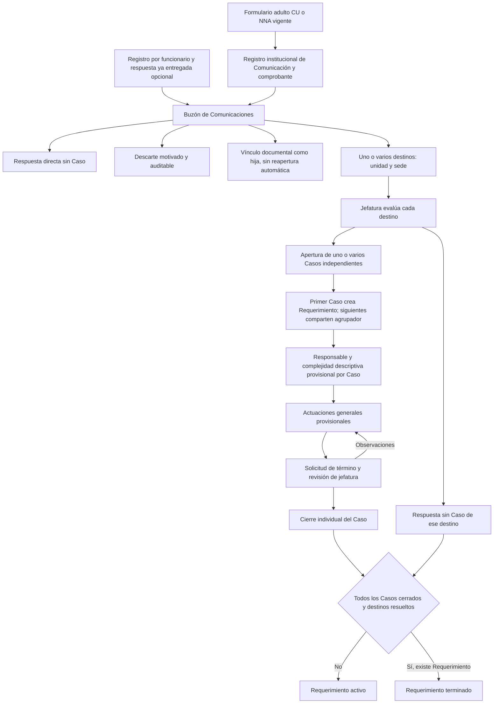

> Actualización vigente 20-10: F04 ya está confirmada por Benjamín. F05–F09 habilitan evaluación y decisión de reapertura ordinaria según [V8](ANTECEDENTES_Y_REAPERTURAS_LAB.md). Las restricciones descritas abajo corresponden a la entrega inicial y se conservan como historia; rechazo/cancelación de derivaciones y reapertura de DERIVACION siguen pendientes.

# Referencia provisional aportada por el usuario · 19-10-2026

**Referencia de la entrega inicial.** El acceso propio, cierre BAJA y solicitud/aceptación se actualizan en [la siguiente iteración](COMPLEJIDAD_Y_DERIVACION_LAB.md), sin atribuir aprobación al procedimiento completo.

No se encontró un archivo con este nombre en el repositorio ni en sus directorios de antecedentes. Esta transcripción resume el flujo y las restricciones expresas recibidos en el encargo y las imágenes adjuntas. **Es una propuesta para validación, no aprobación DDN.** Las restricciones del encargo prevalecen sobre las flechas del diagrama que podrían sugerir derivación automática o identificación adulta alternativa.

- Dos Casos en una misma unidad son válidos. Unidad, sede y rol son dimensiones separadas.
- Cerrar un Caso no resuelve automáticamente el destino. Su evaluación requiere decisión explícita provisional de jefatura; al finalizar no admite nuevos Casos. Esta semántica requiere validación DDN.
- Jefatura puede gestionar personalmente y decidir el término de su propio Caso después de registrar una actuación.
- La derivación entre Casos conserva conceptualmente el Requerimiento, pero su ejecución está deshabilitada hasta definir autorización, aceptación y cierre del origen. Reapertura y redistribución también permanecen pendientes.
- Vincular conserva el original y crea aviso interno al responsable de un Caso explícitamente referenciado; sin referencia, el destinatario queda pendiente. No implica incorporación automática, reapertura ni envío externo.
- No se implementan materias, competencias territoriales, bitácoras sectoriales, plazos, adjuntos, maestro de personas ni reglas de mismo asunto. La clasificación o región declarada no decide destino.
- Códigos recibidos: UPD Promoción y Difusión de Derechos; UPR Protección de Derechos y Representación Judicial; UEP Estudios, Publicaciones y Estadísticas; UGI Gestión Institucional. No se proporcionaron sedes ni personas reales.

